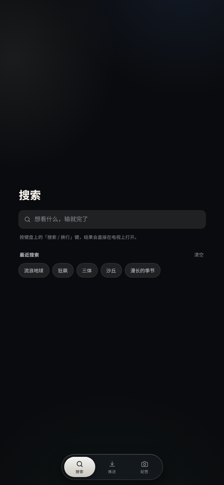
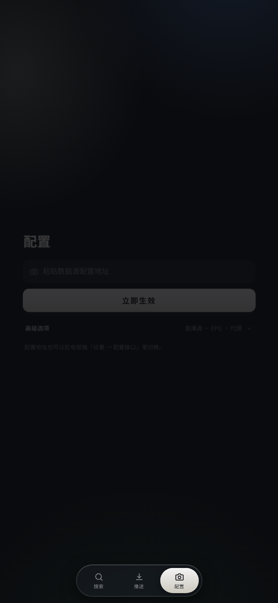

# 影盒 · Box 个人定制版

基于 [takagen99/Box](https://github.com/takagen99/Box) 的个人定制分支。这一版主要做了两件事：**手机助手（网页遥控端）全新 UI**，以及**电视端界面整体重做**。

<p align="center">
  
  &nbsp;&nbsp;
  
</p>

## 手机助手 · 全新 UI

电视端内置的网页遥控（手机浏览器访问电视 IP 即可打开），整套界面推倒重做：

- **三页式结构**：搜索 / 推送 / 配置，底部 Dock 导航，单手可达
- **搜索页**：大输入框「想看什么，输就完了」+ 最近搜索胶囊（点击直接重搜），按键盘上的「搜索 / 换行」键，结果直接在电视上打开
- **配置接口页**：粘贴数据源配置地址 → 「立即生效」，电视端自动刷新；「高级选项」折叠了直播源 · EPG · 代理；配置地址也可以在电视端「设置 → 配置接口」里切换
- **视觉**：深色底 + 玻璃卡片 + 浅色主按钮 + 胶囊式焦点态，文案全部口语化

对应代码：`res/raw/index.html`、`script.js` 重写，新增 `yhg.css`，`RemoteServer.java` 配套调整。

## 电视端 · 界面重做

- **启动页**：新增 `SplashActivity` + `SplashTheme`（原来启动直接进 HomeActivity）
- **首页重构**：豆瓣推荐流（`DoubanFragment` + `DoubanApi`）、海报卡片 `PosterCardLayout`、加载骨架屏 `SkeletonView`、背景大图 + 毛玻璃（`BackdropLoader` + `BlurUtil`）、`HomeCache` 缓存
- **详情页重做**：评分胶囊（`bg_rate_pill`）、播放 / 收藏 / 更多操作（`ic_d_*`）、`DetailMoreDialog`
- **横向栏目「更多」**：`RailMoreDialog`；**配置接口弹窗**：`ConfigApiDialog`
- **全部对话框统一新视觉**（`dialog_*` 共 24 个）：玻璃卡片（`bg_glass_card`）、圆角胶囊、焦点选择器（`sel_pill_*` / `sel_setting_*`）
- **新应用图标**（多密度）+ 默认背景 `app_bg.jpg`

改动规模：**166 个文件，+8908 / −4647**。

## 构建

Android Studio 打开根目录，或直接 `gradlew assembleRelease`。

## 编辑 App 默认设置

`/src/main/java/com/github/tvbox/osc/base/App.java`

```java
private void initParams() {
    putDefault(HawkConfig.HOME_REC, 2);       // Home Rec 0=豆瓣, 1=推荐, 2=历史
    putDefault(HawkConfig.PLAY_TYPE, 1);      // Player   0=系统, 1=IJK, 2=Exo
    putDefault(HawkConfig.IJK_CODEC, "硬解码");// IJK Render 软解码, 硬解码
    putDefault(HawkConfig.HOME_SHOW_SOURCE, true);  // true=Show, false=Not show
    putDefault(HawkConfig.HOME_NUM, 2);       // History Number
    putDefault(HawkConfig.DOH_URL, 2);        // DNS
    putDefault(HawkConfig.SEARCH_VIEW, 2);    // Text or Picture
}
```

## 分支说明

- 上游：[takagen99/Box](https://github.com/takagen99/Box)（`origin`，仅用于拉取更新）
- 本人 fork：[woshiliuxu/Box](https://github.com/woshiliuxu/Box)（`mine`）
- 定制改动在 `local-wip-20261105` 分支，基线上游 `258a5fe`
