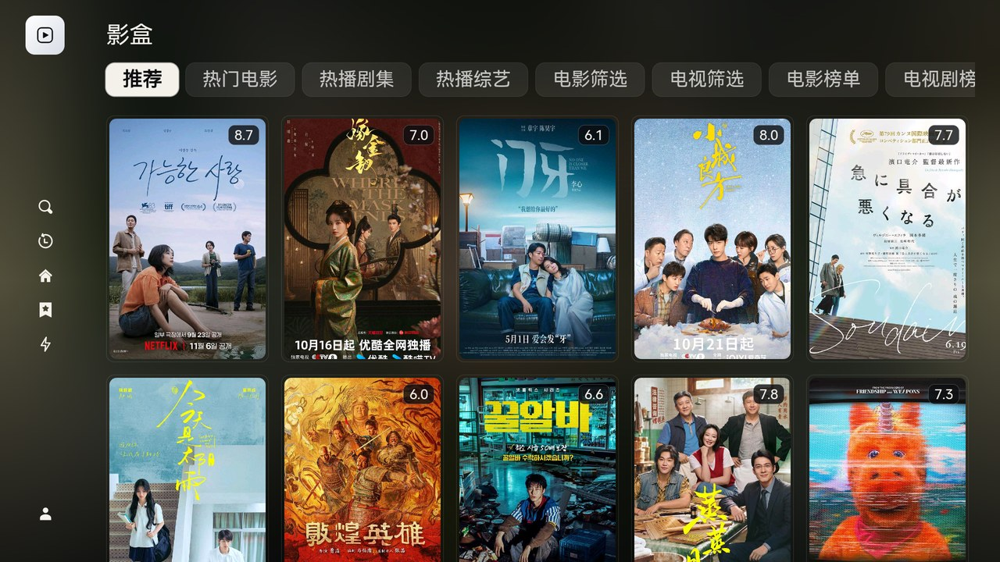
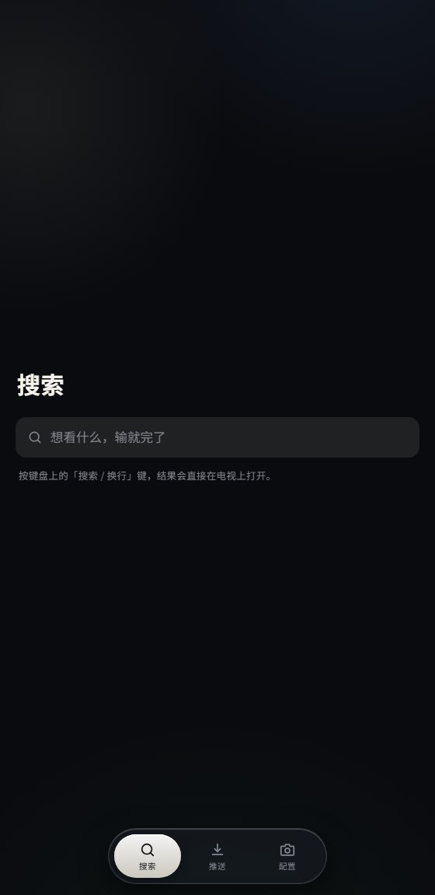
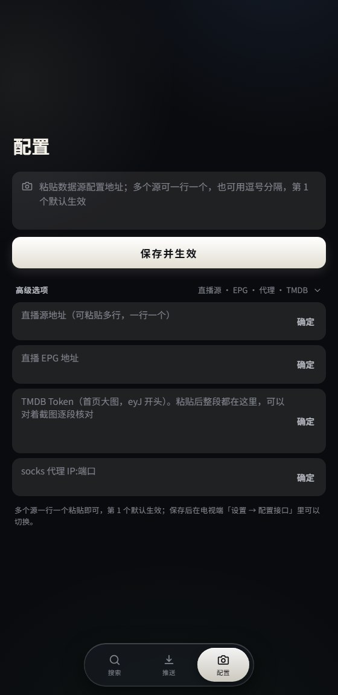
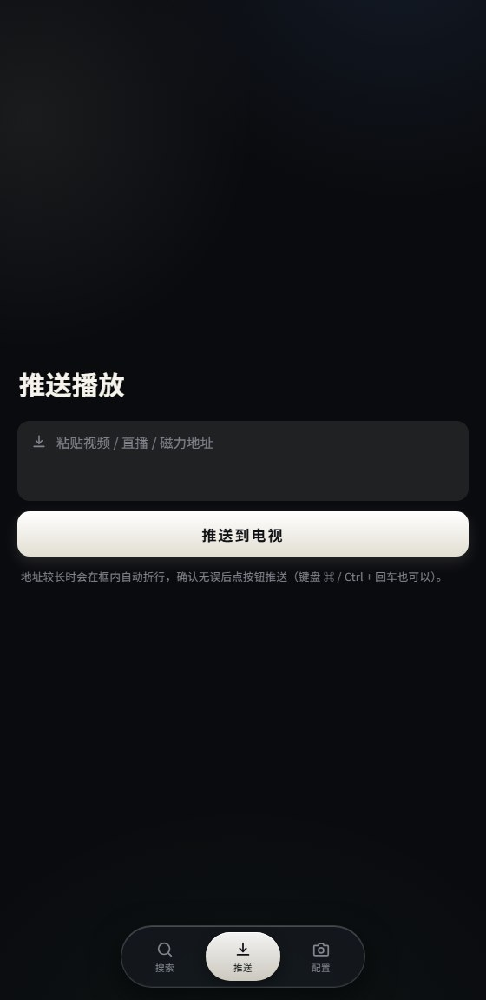

# 影盒 · yinghe

基于 [takagen99/Box](https://github.com/takagen99/Box) 重做的电视端影视播放器壳。

**纯壳原则：不内置任何数据源、不内置任何第三方密钥。** 首次启动直接弹出扫码配置面板，所有需要输入的内容（数据源、直播源、EPG、TMDB 密钥、代理）一律在手机端网页配置，电视端只出二维码。

<p align="center">
  
</p>
<p align="center"><sub>首页：TMDB 高清大图轮播 + 右缘缩略图切换器，8 秒自动换剧照</sub></p>

<p align="center">
  
</p>
<p align="center"><sub>海报墙：豆瓣热门榜（电影/剧集交错），带评分角标，6 分以下自动过滤</sub></p>

<p align="center">
  
  &nbsp;&nbsp;
  
  &nbsp;&nbsp;
  
</p>
<p align="center"><sub>手机助手：搜索 / 配置（多行文本域 + 批量粘贴）/ 推送，手机浏览器访问电视 IP 即可</sub></p>

## 电视端

- **首页大图（TMDB）**：热门影片高清剧照轮播，右缘竖排缩略图切换，一部片多张剧照 8 秒自动轮换；用户未配置 TMDB 密钥时自动回落豆瓣海报墙，**不内置任何密钥**
- **海报墙（豆瓣热门榜）**：与豆瓣首页「热门电影 / 热门剧集」同源实时热度序（rexxar 集合接口），信息行含国家 / 类型 / 主演，剧集带更新进度；**评分 < 6.0 自动过滤**（未开分的新片保留）
- **配置中心（弹窗双栏）**：左侧配置列表（点行切换、行内删除、使用中徽标、计数与滚动渐隐）+ 右侧手机端二维码；**空态**显示三步引导（扫码 → 粘贴 → 自动重启），已配置 TMDB 时显示状态卡（类型 / 掩码 Token / 配置日期）
- **设置页重做**：左栏三分组（首页 / 播放器 / 系统）+ 右侧选项行，玻璃质感统一视觉
- **详情页**：视频预览窗、线路 / 音轨 / 分辨率胶囊、分页选集网格
- **纯壳兜底**：无配置首次启动直接弹扫码面板，绝不弹「重试」错误框死胡同

## 手机助手（网页遥控端）

- **搜索**：回车即搜，最近搜索历史一键重搜
- **配置**：全部输入都是**多行文本域**——数据源支持**一次粘贴多个**（换行 / 逗号 / 分号分隔，第 1 个默认生效），超长 TMDB Token 自动折行可逐段核对；多行字段回车 = 换行，Ctrl/⌘ + 回车提交
- **推送**：粘贴视频 / 直播 / 磁力地址直接推到电视播放
- iOS 原生规范布局：大标题 + 裸放搜索栏 + 全宽主按钮，配置保存后电视端自动落盘并重启生效

## 版本与发版

版本历史与发版流程见 [RELEASES.md](RELEASES.md)。版本号唯一来源 `app/build.gradle` 顶部的 `appVerName` / `appVerCode`；每个版本对应 git tag（`v0.11.x` 起）。

## 构建

Android Studio 打开根目录，或只打目标设备的单 ABI 包：

```
gradlew assembleArmeabiGenericNormalDebug
```

## 分支说明

- 上游：[takagen99/Box](https://github.com/takagen99/Box)（`origin`，仅用于拉取更新）
- 本仓库：[woshiliuxu/yinghe](https://github.com/woshiliuxu/yinghe)（`mine`，默认分支 `main`）
- 全部定制改动都在 `main` 分支，基线上游 `258a5fe`

## 声明

本项目仅为播放器壳，不提供、不内置任何影视数据源；使用前请自行配置合法的播放来源，并遵守当地法律法规。
